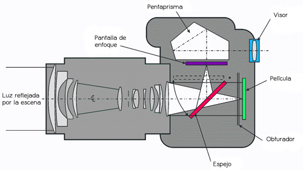
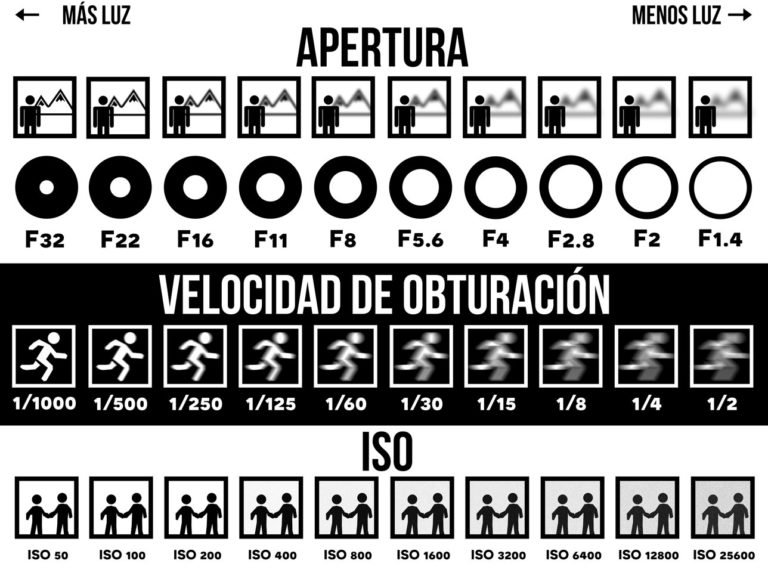
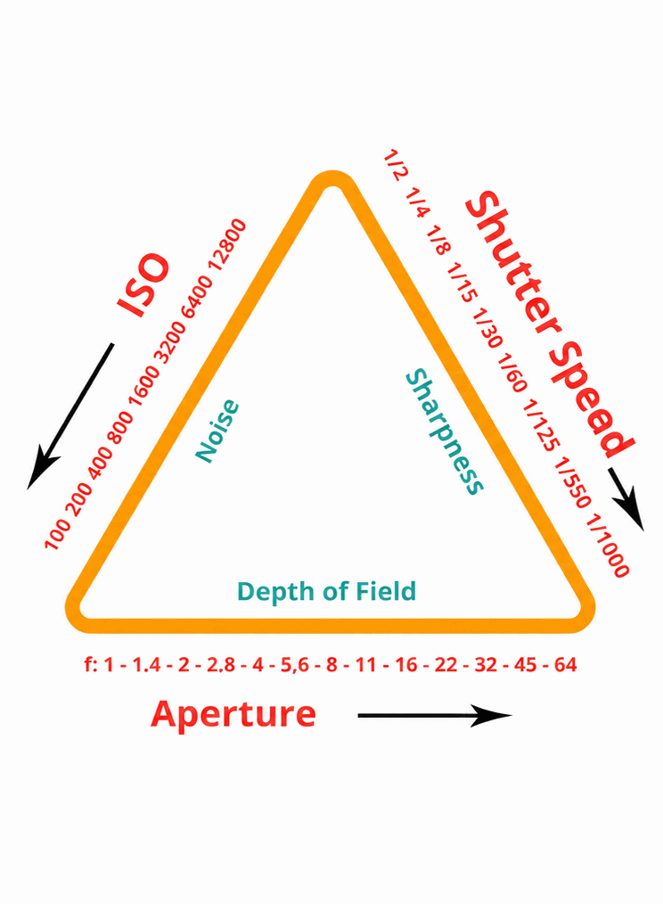
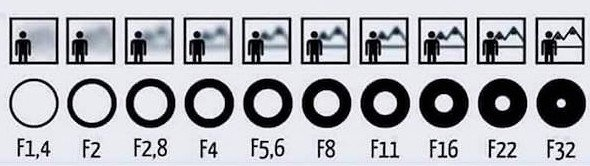
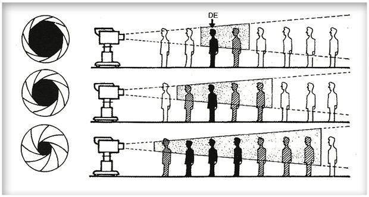
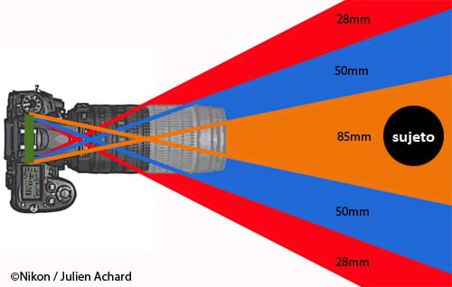
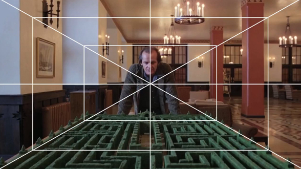

## Before we start

This document comes **after** the workshop, not before. For four hours we opened the camera, loaded a film and made photographs with the exposure triangle in hand. Here is the summary of what we did, the numbers you do not need to memorise, the exercises to carry on alone and the references to go further.

How it is organised:

- The body of the document follows the order of the workshop. You can read it straight through.
- The tables are for reference: you do not need to know the aperture scales by heart, only how to read them.
- The appendices hold the more technical part (the photochemical process, film formats) and the resources: simulators and bibliography.

## Why an analogue camera

The photography of a lifetime. The argentic one, the chemical one, the one used for a hundred and forty years and still today the most honest way to learn how to expose. It is not better than digital: it is different, and that difference is what interests us.

An analogue camera does not lie. There is no screen telling you whether the shot worked, no histogram correcting your decision, no immediate second chance. You have to think before you shoot, and when you shoot you have to trust what you decided. That is what makes you learn fast: every roll is 36 decisions (24 or 12, depending on the film), not 36,000.

There is also the film as an object. You put it in the camera, you advance it, you finish it, you develop it and you get a negative. The photograph exists somewhere physical. For many people that is the whole point; for you it may be just the means. It does not matter: what you learn here works just as well with a digital camera.

**If you come from digital.** Put the camera in manual mode, set the ISO to 400, pick a focal length and do not move it. Do the maths: you have 36 photographs, like a roll of film. The limit is what teaches you.

## The camera: a box of light

A camera is a box that lets light in for a set amount of time. Everything inside it exists to control how much light gets in and for how long.

- **The lens** gathers the light and makes it converge towards the film.
- The **aperture** is the hole the light passes through. It opens and closes in steps, and each step is double or half the light.
- The **shutter** is the curtain that uncovers the film for a time: a second, a hundredth, a thousandth.
- The **viewfinder** shows you what will enter the frame (more or less accurately depending on the camera type).
- The **light meter** measures the light in the scene and suggests a combination. Most cameras from the 1970s onwards have one; older mechanical ones do not.
- The **film advance** and the **rewind** move the film frame by frame.

By type, you will come across compacts, rangefinders, SLRs, twin-lens reflexes (TLR) and medium and large format cameras. To begin with you do not need to choose: any camera that works and that you understand is a good one. What you do need to know is how to load it.

### Loading the film

This is the number one beginner mistake and it has nothing to do with exposure: the film did not catch and you came home with an empty camera.

1. Open the back in dim light, never in the sun.
2. Place the film on the correct side and pull the leader to the slot on the take-up spool.
3. Hook it properly, into the spool hole or the slot, and turn the crank a couple of times so it sits tight.
4. **Check the fit**: make sure the perforations in the film line up with the sprockets that drive it. If they do not line up, the film will not advance even if the crank turns.
5. Close the back.
6. **Check it with the back closed**: advance with the lever and watch the rewind knob. It must turn. If it does not move, the film has not caught.
7. Watch the counter: it must be going up.

If at any point the advance lever feels very loose, stop: it is a sign that the film has come off.

## Light, time and sensitivity

All photography comes down to three variables and one question: how much light does the film need for the image to register properly?

- **How much light gets in**: the aperture.
- **For how long it gets in**: the shutter speed.
- **How much light it needs**: the ISO speed of the film.

Think of a tap. The aperture is how far you open the tap; the shutter speed is how many seconds you leave it open; the ISO is the size of the glass you put underneath. If you open the tap wider, you have to close it sooner. If the glass is smaller, you have to fill it for less time and empty it.

## The exposure triangle

The three variables move together. Changing one forces you to move another, and that is the whole point: every possible combination gives you a different photograph.

### Aperture

The aperture is measured in f-numbers. The bigger the number, the smaller the hole and the less light gets in. Each step on this scale is exactly double or half the light:

| f/1.4 | f/2 | f/2.8 | f/4 | f/5.6 | f/8 | f/11 | f/16 | f/22 |
|-------|-----|-------|-----|-------|-----|------|------|------|

From f/4 to f/5.6 is one stop: half the light. From f/4 to f/8 is two stops: a quarter.

### Shutter speed

The time the shutter lets the light in. The standard scale also goes in doubles:

| 1 s | 1/2 | 1/4 | 1/8 | 1/15 | 1/30 | 1/60 | 1/125 | 1/250 | 1/500 | 1/1000 |
|-----|-----|-----|-----|------|------|------|-------|-------|-------|--------|

Below the shutter speed that matches your focal length, your pulse starts to show. With a 50 mm, shoot at 1/60 or faster. With a 135 mm, at 1/250.

### ISO

The speed of the film. You will find it as ISO or ASA: 100, 200, 400, 800, 1600. The higher it is, the less light you need and the more grain you get. To start with, **400** is the most versatile film: it works by day and by night, and the grain it gives is part of the charm.

### The three scales compensate each other

These five combinations give exactly the same amount of light, but not the same photograph:

| Aperture | Shutter speed | Result |
|----------|---------------|--------|
| f/4 | 1/500 | Blurred background, frozen action |
| f/5.6 | 1/250 | Balance, outdoor portrait |
| f/8 | 1/125 | Everything sharp, still people |
| f/11 | 1/60 | Landscape, foreground and background sharp |
| f/16 | 1/30 | Plenty of depth of field, risk of shake |

This table is the heart of the workshop. When in doubt, decide first what you want to happen (blurred background? frozen action?) and adjust the rest.

There is no perfect exposure. There is the one you want. A dark photograph can be a mistake or it can be a decision; the negative does not distinguish between the two, and that gives you complete freedom.

## Inside the film: why there is no second chance

When you shoot, light strikes the film and leaves a **latent image**: an invisible difference in silver that will only become visible in the developer. From that moment the image is already taken. There is no preview, no delete, no identical second take.

Every film allows a margin of error. Black and white negative has **latitude**: you can be a couple of stops off and the print can still be saved. Slide film has none: half a stop and the shot is gone. That is a good reason to start with black and white.

And then **grain**: the higher the ISO, the larger the silver crystals and the more visible the texture. Grain is not a defect. Many of the photographs you remember are grainy because the film was 400 and the light was low.

## Metering the light

A light meter does not think: it measures. Its job is to give you a combination of aperture and shutter speed that leaves the image at a middle grey. That grey is 18% of the light, and it is the underlying flaw of the whole system: **the meter wants everything to be middle grey**.

There are two ways to meter:

- **Incident light**: you measure the light falling on the subject, with a handheld meter or by holding your hand or a card in front of the lens. It is the most reliable method, because it measures the actual light and not what each thing reflects.
- **Reflected light**: you measure the light the scene sends towards the camera. That is what the built-in meter does. It is convenient, but it is wrong whenever the scene is not grey.

When the meter lies, and it will tell you the truth:

| Scene | What the meter does | What you have to do |
|-------|---------------------|---------------------|
| Snow, beach, very bright sky | Turns it grey and dark | Open 1 or 2 stops |
| Black object, dark scene | Turns it grey and light | Close 1 stop |
| Backlight, window behind | Underexposes the subject | Open 1½ stops or meter close up |
| Gig, night, point lights | Overexposes | Close 1 or 2 stops and accept the black |

With negative film, **expose for the shadows**: shadows hold information and highlights can burn out. With slide film, the opposite: expose for the highlights.

## Depth of field

Depth of field is the distance in front of and behind the focused point that comes out sharp. It depends on three things:

- **Aperture**: the wider open (f/2.8), the less depth of field.
- **Focal length**: the longer the lens (135 mm), the less depth of field.
- **Distance to the subject**: the closer you are, the less depth of field.

| You want | Aperture | Example |
|----------|----------|---------|
| To isolate the subject from the background | f/2 to f/4 | Portrait, detail, still life |
| A group of two or three people | f/5.6 to f/8 | Group portrait |
| The whole scene sharp | f/11 to f/16 | Landscape, architecture, street |

**Bokeh** is the way things out of focus are blurred, and it depends on the number of blades in the aperture and on the distance between the subject and the background. It is not the same as depth of field: it is the character of the blur.

## Focal length and perspective

Focal length is the distance between the centre of the lens and the plane where the image forms, and it is measured in millimetres. On 35 mm, **50 mm is the normal lens**: it gives roughly the field of view of the human eye.

| Focal length | Angle | What for |
|--------------|-------|----------|
| 14–24 mm | Very wide-angle | Architecture, landscape, interiors |
| 28–35 mm | Wide-angle | Street, reportage, landscape |
| 50 mm | Normal | General use, environmental portrait |
| 85–105 mm | Short telephoto | Portrait |
| 135–300 mm | Telephoto | Sport, nature, reportage |

Focal length does not only move you closer or further: **it changes perspective**. With a wide-angle you get close and the background recedes; with a telephoto the background sticks to the subject and the planes compress.

## Composition

Exposure decides whether the photograph is visible. Composition decides whether it is worth looking at. There are no rules, only decisions that work more often than others.

### The frame is a decision

Framing is choosing what stays out. Before you shoot, ask yourself what you are really interested in and take out of the frame everything that has nothing to do with it. Most weak photographs are weak because there is too much in them.

### Where you put the camera

It is the cheapest change and the one people make least. Crouch down, stand on a chair, move half a metre closer. A viewpoint at everyone's eye level produces a photograph everyone has already taken. A viewpoint at the level of the subject (a child, a dog, a cup) is already a different photograph.

### The background

The background is half the photograph and almost nobody looks at it. A perfect subject against a background of trees, streetlights and litter does not work. Move two steps and look at what is behind: look for a clean background, a flat colour or a texture that does not compete.

### Lines and horizon

Lines guide the eye. A diagonal gives movement; a horizontal, calm; a vertical, order. The horizon does not have to sit in the middle out of habit: put it on a third, up or down, depending on whether you want the sky or the ground to dominate.

### Air, tension and crops

Leave air in the direction the subject is looking or walking; if you pin them to the edge, the photograph suffocates. Do not crop through joints (wrists, knees, ankles); crop through the middle of the arm or the thigh. And if you have to crop, crop with intent, not because it did not fit.

### Rule of thirds

Divide the frame into three horizontal bands and three vertical ones. The points where they cross are places where the eye rests. It is not a law and breaking it often works better, but until you have your own judgement it is a good safety net.

### The moment

In street and people photography, the moment is the content. Waiting half a second longer can change the photograph: a glance, a hand, a gesture. With an analogue camera you have no burst mode, and that forces you to anticipate. Often that is an advantage.

### The order of decisions

1. What do I want to say with this photograph?
2. Where do I stand?
3. What comes into the frame and what stays out?
4. What focal length do I need?
5. Only at the end: what exposure.

Doing it in this order is what separates a considered photograph from a snap.

## Practice: six exercises with one film

One film is 36 photographs (24 or 12, depending on the roll). These six exercises will keep you going for two or three films, and each one teaches you something you cannot learn by reading.

1. **One focal length, the whole film.** Choose a 50 mm (or do not move the zoom) and shoot all 36 with it. Move yourself to frame, not the lens.
2. **The three steps.** The same static subject at f/2.8, f/8 and f/16, adjusting the shutter speed each time. Compare the three prints when you get them.
3. **Freeze and smear.** The same movement (a person walking, water, a swing) at 1/500, 1/60 and 1/15. The last two with a tripod or with your body well braced.
4. **The meter against the world.** A scene with snow, a black object and a backlight, metered the way the camera suggests and metered your way. Write down what you did.
5. **Three viewpoints.** Choose a single subject and photograph it from three different heights. Then pick one.
6. **Manual bracketing.** The same subject at the "correct" exposure, one stop over and one stop under. It teaches you how much a stop is.

**Workshop tip:** write down every frame in a notebook (number, place, aperture, shutter speed). Without that, when the negative comes back you will not know why a photograph turned out the way it did, and the learning is lost.

## Common mistakes

| Symptom | Cause | Solution |
|---------|-------|----------|
| Every photograph is blurred | Shutter speed too low for the focal length | 1/60 or faster, or a tripod; breathe out before shooting |
| The negative is thin and washed out | Underexposure, often from a very bright background | Open 1 or 2 stops; meter close up |
| The negative is very dark | Overexposure, dark scene | Close 1 stop; remember negative film has latitude |
| There are only 8 or 12 frames | The film did not catch | Load again and check the rewind tension |
| A dark band or streaks | Film badly seated or an irregular shutter | Check the loading; if it is the camera, ask us |
| The film is fogged | The camera was opened in the light or the film was removed without rewinding | Always rewind before opening |
| People cropped or distorted | Too close with a wide-angle | Step back or change focal length |
| Boring photographs | There was no decision about viewpoint | Go back to composition: where you stand and what you leave out |

## What to do with the film

- **Do not open it.** Not even out of curiosity: the light would fog it in seconds.
- Keep it somewhere dry and cool, away from the heat of a car or direct sun.
- Develop it soon. The latent image degrades over time, especially with heat.
- **Keep the negative.** It is the original. Prints can be made again; the negative cannot be recovered.
- Always ask for **development and a contact sheet**. The contact sheet is your map: you will see all 36 photographs together and understand at a glance what you did right.

Development is not included in the workshop. It is done in the [B/W Developing Workshop](/en/tallers/revelat-bn/) or at any lab you trust.

## To keep going

With the film developed and the notebook in your hand you have what you need. If you want to carry on:

- **Develop it yourself**: [B/W Developing Workshop](/en/tallers/revelat-bn/) and [Introduction to Developing](/en/tallers/iniciacio-revelat/).
- **Go out and shoot**: [Street Photography](/en/tallers/fotografia-de-carrer/).
- **Build a simple camera**: [Pinhole Photography](/en/tallers/fotografia-estenopeica/).
- **Portraits with the light there is**: [Analogue Portrait](/en/tallers/retrat-analogic/).
- **To understand why we call ourselves chemists**: [Analogue or chemical photography?](/blog/fotografia-analogica-o-quimica/) (in Catalan).

And one practice recommendation: one film a month, one theme, one focal length. After a year you will have twelve themes and your own judgement, which is far more than any course gives you.

## Cheat sheet

**The three scales** (each step, half or double the light)

| | | | | | | |
|---|---|---|---|---|---|---|
| Aperture | 2 | 2.8 | 4 | 5.6 | 8 | 11 |
| Shutter speed | 1/500 | 1/250 | 1/125 | 1/60 | 1/30 | 1/15 |
| ISO | 100 | 200 | 400 | 800 | 1600 | 3200 |

**Five settings to start with**

| Situation | Aperture | Shutter speed | ISO |
|-----------|----------|---------------|-----|
| Outdoor portrait | f/2.8 | 1/250 | 400 |
| Landscape in daylight | f/11 | 1/125 | 100 |
| Street, people moving | f/8 | 1/250 | 400 |
| Deliberate motion | f/11 | 1/15 | 100 |
| Low light indoors | f/2 | 1/30 | 800 |

**Before you shoot, four questions:** what do I want to say, where do I stand, what comes into the frame, what exposure.

**Before you leave home:** film loaded and checked, counter at zero, battery or cell, lens cap, notebook.

## Appendix A · The photochemical process

Argentic photography is based on a material sensitive to light: a gelatine emulsion with **silver halides** (bromide, chloride, iodide) coated on a flexible support, usually cellulose acetate or polyester.

When light strikes it, the silver halides react and form a **latent image**: a distribution of metallic silver invisible to the eye. The larger the silver halide crystals, the more sensitive the emulsion and the more grain it gives; that is the difference between ISO 100 and ISO 1600.

In **development**, the developer reduces the exposed halides to black metallic silver and makes the image visible. The **fixer** stops the process and removes the halides that were not exposed, so the image does not keep developing in the light. The result is the **negative**: the light values are reversed.

To obtain a positive image, light is passed again through the negative onto a light-sensitive paper (**printing**, by enlargement or by contact). With slide film, on the other hand, development gives a positive directly.

## Appendix B · Film formats and types

| Format | Size | Where you find it |
|--------|------|-------------------|
| 135 (35 mm) | 24 × 36 mm | Most SLRs and compacts |
| 120 (medium format) | 6 × 4.5 / 6 × 6 / 6 × 7 cm | Medium format SLRs, TLRs, rangefinders |
| Instant | Polaroid, Fuji Instax | Instant cameras |
| Large format | 4 × 5", 5 × 7", 8 × 10" | Technical and field cameras |

| Type | What it gives | What for |
|------|---------------|----------|
| B/W negative | Greyscale image, wide margin of error | Learning, street, portrait |
| Colour negative | Colours complementary to the negative | General colour work |
| Slide (reversal) | Direct positive, no latitude | Projection, magazines, exact colour |
| Infrared B/W | Unreal tones, halo effect | Experimentation |
| Lith or line film | Extreme contrast, pure black and white | Graphic work, art printing |

## Appendix C · Simulators and resources

- **CameraSim** · [camerasim.com](https://www.camerasim.com/). The classic simulator: a scene with movement and depth where you change aperture, shutter speed and ISO and watch the blur, the movement and the grain change live. It has two versions, *Original CameraSim* and *Exposure Contraption*, the second like a mechanical still life where you build the exposure piece by piece.
- **Photoskop** · [photoskop.com](https://photoskop.com/). Interactive lessons with studio scenes: exposure, movement and lenses, moving controls instead of reading theory.
- **Pick a theme and one film a month**: it is not an app, it is a method. One theme, one focal length, 36 photographs.

## Appendix D · Bibliography

**Technique and exposure**

- Ansel Adams, *The Camera* (1980), *The Negative* (1981) and *The Print* (1983). Little, Brown.
- Henry Horenstein, *Black and White Photography: A Basic Manual*. Little, Brown.
- Michael Langford, *Basic Photography*. Focal Press.
- Bryan Peterson, *Understanding Exposure*. Amphoto Books.
- Bruce Barnbaum, *The Art of Photography*. Rocky Nook.

**The darkroom**

- Steve Anchell and Bill Troop, *The Film Developing Cookbook*. Focal Press.
- Steve Anchell, *The Darkroom Cookbook*. Focal Press.

**Composition and looking**

- Michael Freeman, *The Photographer's Eye*. Ilex Press, 2007.
- Henri Cartier-Bresson, *The Decisive Moment*. 1952.
- Stephen Shore, *The Nature of Photographs*. Phaidon, 2007.
- David Hurn and Bill Jay, *On Being a Photographer*. LensWork, 1997.

**Thinking about photography**

- Susan Sontag, *On Photography*. 1977.
- Roland Barthes, *Camera Lucida*. 1980.
- Joan Fontcuberta, *La cámara de Pandora*. Gustavo Gili, 2010.

**From home**

- Llumàtics, [Analogue or chemical photography?](/blog/fotografia-analogica-o-quimica/) (in Catalan). Why we say chemical when everyone says analogue.

## Appendix E · Glossary

- **Aperture**: the hole in the lens that controls the amount of light. Measured in f-numbers.
- **Shutter**: the device that uncovers the film for a set time.
- **ISO / ASA**: the film's sensitivity to light. Higher ISO, less light needed and more grain.
- **Stop**: the unit of exposure change. One stop is double or half the light.
- **EV**: exposure value. Sums up a combination of aperture and shutter speed in a single number.
- **Depth of field**: the distance in front of and behind the focused point that comes out sharp.
- **Bokeh**: the character of the out-of-focus blur.
- **Focal length**: the distance between the optical centre of the lens and the image plane, in mm.
- **Hyperfocal distance**: the focus distance from which everything is sharp to infinity.
- **Exposure latitude**: the margin of error a film tolerates without losing the image.
- **Grain**: the visible texture produced by silver halide crystals.
- **Latent image**: the invisible image left on the film when you shoot.
- **Negative**: an image with the light values reversed, as it comes out of development.
- **Positive**: an image with the correct values, obtained by printing or with slide film.
- **Developer**: the solution that turns the latent image into visible metallic silver.
- **Fixer**: the solution that stops development and makes the image stable.
- **Light meter**: the device that measures light and suggests an exposure.
- **18% grey**: the middle grey the meter uses as a reference and wants to impose on the whole scene.
- **Contact sheet**: a positive copy of the whole negative on a single sheet, for choosing frames.
- **Fogging**: accidentally exposing the film to light.

