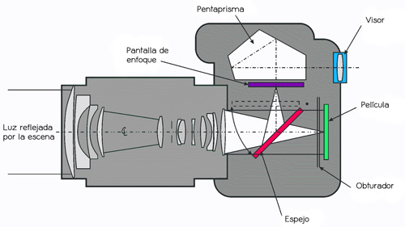
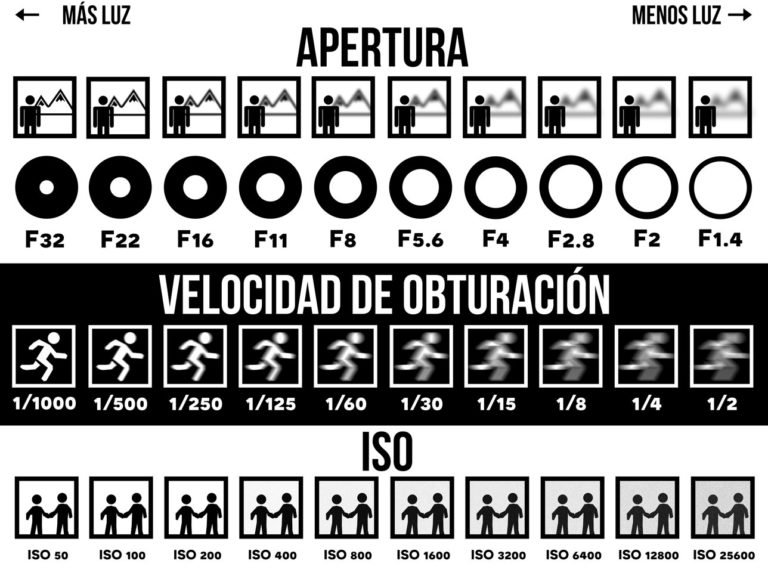
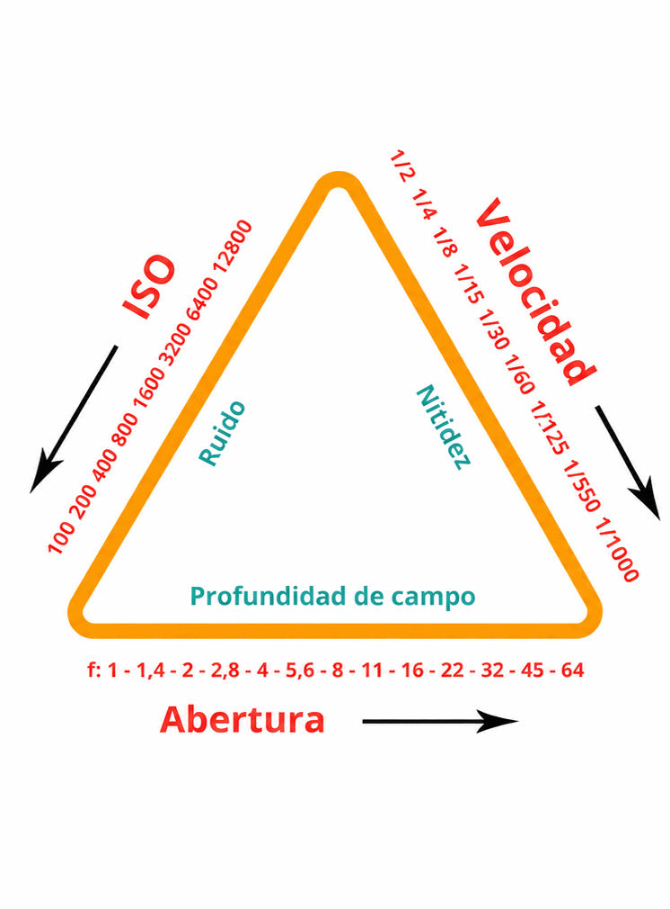
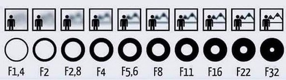
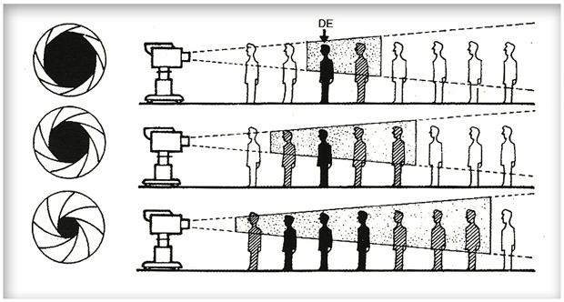
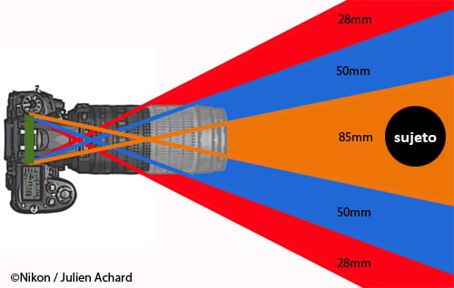
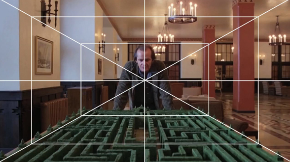

## Antes de empezar

Este documento llega **después** del taller, no antes. Durante cuatro horas hemos abierto la cámara, hemos cargado un carrete y hemos hecho fotos con el triángulo de exposición en la mano. Aquí tienes el resumen de lo que hicimos, los números que no hace falta memorizar, los ejercicios para seguir solo y las referencias para ir más allá.

Cómo está organizado:

- El cuerpo del documento sigue el orden del taller. Se puede leer del derecho.
- Las tablas son de consulta: no hace falta saberse las escalas de diafragma de memoria, solo saber leerlas.
- Los apéndices guardan la parte más técnica (el proceso fotoquímico, los formatos de carrete) y los recursos: simuladores y bibliografía.

## Por qué una cámara analógica

La fotografía de toda la vida. La argéntica, la química, la que se usó durante ciento cuarenta años y que todavía hoy es la manera más honesta de aprender a exponer. No es mejor que lo digital: es distinta, y esa diferencia nos interesa.

Una cámara analógica no miente. No hay pantalla que te diga si la foto ha salido bien, no hay histograma que te corrija la decisión, no hay segunda oportunidad inmediata. Tienes que pensar antes de disparar, y cuando disparas tienes que confiar en lo que has decidido. Eso es lo que hace que aprendas deprisa: cada carrete son 36 decisiones (24 o 12, según el rollo), no 36.000.

También está el carrete como objeto. Lo pones en la cámara, lo avanzas, lo acabas, lo revelas y obtienes un negativo. La foto existe en algún sitio físico. Para mucha gente eso es el motivo; para ti quizá sea solo el medio. Da igual: lo que aprendes aquí sirve igual con una cámara digital.

**Si vienes de lo digital.** Pon la cámara en modo manual, fija el ISO a 400, elige una distancia focal y no la muevas. Echa cuentas: tienes 36 fotos, como un carrete. El límite es lo que enseña.

## La cámara: una caja de luz

Una cámara es una caja que deja entrar luz durante un tiempo determinado. Todo lo que tiene dentro sirve para controlar cuánta luz entra y durante cuánto tiempo.

- **El objetivo** recoge la luz y la hace converger hacia la película.
- El **diafragma** es el agujero por donde pasa la luz. Se abre y se cierra en pasos, y cada paso es el doble o la mitad de luz.
- El **obturador** es la cortinilla que descubre la película durante un tiempo: un segundo, una centésima, una milésima.
- El **visor** te deja ver qué entrará en el encuadre (con más o menos exactitud según el tipo de cámara).
- El **fotómetro** mide la luz de la escena y propone una combinación. La mayoría de cámaras de los años setenta en adelante llevan uno; las mecánicas más antiguas, no.
- El **avance** y el **rebobinado** mueven el carrete foto a foto.

Por tipo, te encontrarás compactas, telémetros (rangefinder), réflex (SLR), de dos objetivos (TLR) y de medio y gran formato. Para empezar no hace falta elegir: cualquier cámara que funcione y que entiendas es buena. Lo que sí tienes que saber hacer es cargarla.

### Cargar el carrete

Es el error número uno del principiante y no tiene nada que ver con la exposición: el carrete no ha enganchado y has vuelto a casa con la cámara vacía.

1. Abre la tapa en penumbra, nunca al sol.
2. Coloca el carrete en el lado que le toca y estira la lengüeta hasta la ranura del carrete receptor.
3. Engánchala bien, en el agujero del carrete o en la ranura, y da un par de vueltas a la manivela para que quede firme.
4. **Comprueba el encaje**: mira que los agujeros de la película coincidan con los engranajes que la hacen avanzar. Si no encajan, la película no avanzará aunque la manivela gire.
5. Cierra la tapa.
6. **Compruébalo con la tapa cerrada**: avanza con la palanca y mira la rueda de rebobinado. Tiene que girar. Si no se mueve, el carrete no ha enganchado.
7. Mira el contador: tiene que ir subiendo.

Si en algún momento notas que la palanca de avance va muy floja, párate: es señal de que la película se ha soltado.

## Luz, tiempo y sensibilidad

Toda la fotografía se reduce a tres variables y una pregunta: ¿cuánta luz necesita la película para que la imagen quede bien impresa?

- **Cuánta luz entra**: el diafragma.
- **Durante cuánto tiempo entra**: la velocidad de obturación.
- **Cuánta luz necesita**: la sensibilidad ISO del carrete.

Piensa en un grifo. El diafragma es lo abierta que esté la llave; la velocidad, los segundos que la dejas abierta; el ISO, el tamaño del vaso que pones debajo. Si abres más la llave, tienes que cerrar antes. Si el vaso es más pequeño, tienes que llenarlo menos tiempo y vaciarlo.

## El triángulo de exposición

Las tres variables se mueven juntas. Cambiar una obliga a mover otra, y eso es toda la gracia: cada combinación posible da una foto distinta.

### Diafragma

El diafragma se mide en números f. Cuanto más grande es el número, más pequeño es el agujero y menos luz entra. Cada paso de esta escala es exactamente el doble o la mitad de luz:

| f/1.4 | f/2 | f/2.8 | f/4 | f/5.6 | f/8 | f/11 | f/16 | f/22 |
|-------|-----|-------|-----|-------|-----|------|------|------|

De f/4 a f/5.6 hay un paso: la mitad de luz. De f/4 a f/8 hay dos pasos: una cuarta parte.

### Velocidad de obturación

El tiempo que el obturador deja entrar la luz. La escala estándar también va de doble en doble:

| 1 s | 1/2 | 1/4 | 1/8 | 1/15 | 1/30 | 1/60 | 1/125 | 1/250 | 1/500 | 1/1000 |
|-----|-----|-----|-----|------|------|------|-------|-------|-------|--------|

Por debajo de la velocidad equivalente a tu distancia focal, se te nota el pulso. Con un 50 mm, dispara a 1/60 o más rápido. Con un 135 mm, a 1/250.

### ISO

La sensibilidad del carrete. La encontrarás en ISO o ASA: 100, 200, 400, 800, 1600. Cuanto más alto, menos luz necesitas y más grano obtienes. Para empezar, **400** es el rollo más polivalente: sirve de día y de noche, y el grano que da es parte del encanto.

### Las tres escalas se compensan

Estas cinco combinaciones dan exactamente la misma luz, pero no la misma foto:

| Diafragma | Velocidad | Resultado |
|-----------|-----------|-----------|
| f/4 | 1/500 | Fondo desenfocado, acción congelada |
| f/5.6 | 1/250 | Equilibrio, retrato al aire libre |
| f/8 | 1/125 | Todo nítido, gente quieta |
| f/11 | 1/60 | Paisaje, primer plano y fondo nítidos |
| f/16 | 1/30 | Mucha profundidad de campo, riesgo de trepidar |

Esta tabla es el corazón del taller. Cuando dudes, elige primero qué quieres que pase (¿fondo desenfocado? ¿acción congelada?) y ajusta el resto.

No hay una exposición perfecta. Hay la que quieres. Una foto oscura puede ser un error o puede ser una decisión; el negativo no distingue entre las dos cosas, y eso te da toda la libertad.

## Dentro del carrete: por qué no hay segunda oportunidad

Cuando disparas, la luz impresiona la película y deja una **imagen latente**: una diferencia invisible de plata que solo se hará visible en el revelado. Desde ese momento la imagen ya está tomada. No hay previsualización, no hay borrar, no hay segunda toma idéntica.

Cada carrete permite un margen de error. El negativo en blanco y negro tiene **latitud**: puedes equivocarte un par de pasos y la copia todavía se puede salvar. La diapositiva no tiene ninguna: medio paso y has perdido la foto. Es una buena razón para empezar con blanco y negro.

Y el **grano**: cuanto más alto es el ISO, más grandes son los cristales de plata y más visible es la textura. El grano no es un defecto. Muchas fotografías que recuerdas tienen grano porque la película era de 400 y la luz era poca.

## Medir la luz

El fotómetro no piensa: mide. Su trabajo es decirte una combinación de diafragma y velocidad que deje la imagen en un gris medio. Ese gris es el 18% de la luz, y es el error de fondo de todo el sistema: **el fotómetro quiere que todo sea gris medio**.

Hay dos maneras de medir:

- **Luz incidente**: mides la luz que cae sobre el motivo, con un fotómetro externo o poniendo la mano o una tarjeta delante del objetivo. Es el método más fiable, porque mide la luz real y no lo que refleja cada cosa.
- **Luz reflejada**: mides la luz que la escena envía hacia la cámara. Es lo que hace el fotómetro interno. Es cómodo, pero se equivoca siempre que la escena no es gris.

Cuando el fotómetro miente, y te dirá la verdad:

| Escena | Qué hace el fotómetro | Qué tienes que hacer |
|--------|-----------------------|----------------------|
| Nieve, playa, cielo muy claro | La deja gris y oscura | Abre 1 o 2 pasos |
| Objeto negro, escena oscura | La deja gris y clara | Cierra 1 paso |
| Contraluz, ventana detrás | Subexpone el motivo | Abre 1 paso y medio o mide de cerca |
| Concierto, noche, luces puntuales | Sobreexpone | Cierra 1 o 2 pasos y acepta el negro |

En negativo, **expón para las sombras**: las sombras tienen información y las luces se pueden quemar. En diapositiva, al revés: expón para las luces.

## Profundidad de campo

La profundidad de campo es la distancia por delante y por detrás del punto enfocado que sale nítida. Depende de tres cosas:

- **La apertura**: cuanto más abierto (f/2.8), menos profundidad de campo.
- **La distancia focal**: cuanto más tele (135 mm), menos profundidad de campo.
- **La distancia al motivo**: cuanto más cerca estás, menos profundidad de campo.

| Quieres | Apertura | Ejemplo |
|---------|----------|---------|
| Aislar el motivo del fondo | f/2 a f/4 | Retrato, detalle, bodegón |
| Un grupo de dos o tres personas | f/5.6 a f/8 | Retrato de grupo |
| Toda la escena nítida | f/11 a f/16 | Paisaje, arquitectura, calle |

El **bokeh** es la manera en que se desenfoca lo que queda fuera de foco, y depende del número de láminas del diafragma y de la distancia entre el motivo y el fondo. No es lo mismo que la profundidad de campo: es el carácter del desenfoque.

## Distancia focal y perspectiva

La distancia focal es la distancia entre el centro del objetivo y el plano donde se forma la imagen, y se mide en milímetros. En un 35 mm, **50 mm es el objetivo normal**: da aproximadamente el campo de visión del ojo humano.

| Focal | Ángulo | Para qué |
|-------|--------|----------|
| 14–24 mm | Muy gran angular | Arquitectura, paisaje, interiores |
| 28–35 mm | Gran angular | Calle, reportaje, paisaje |
| 50 mm | Normal | Uso general, retrato ambiental |
| 85–105 mm | Teleobjetivo corto | Retrato |
| 135–300 mm | Teleobjetivo | Deporte, naturaleza, reportaje |

La focal no solo acerca o aleja: **cambia la perspectiva**. Con un gran angular te acercas y el fondo se aleja; con un tele, el fondo se pega y los planos se comprimen.

## Composición

La exposición decide si la foto se ve. La composición decide si vale la pena mirarla. No hay reglas, hay decisiones que funcionan más a menudo que otras.

### El encuadre es una decisión

Encuadrar es elegir qué queda fuera. Antes de disparar, pregúntate qué es lo que te interesa de verdad y saca del encuadre todo lo que no tiene nada que ver. La mayoría de fotos flojas lo son porque hay demasiadas cosas.

### Dónde pones la cámara

Es el cambio más barato y el que menos se hace. Agáchate, súbete a una silla, acércate medio metro. Un punto de vista a la altura de los ojos de todo el mundo produce una foto que todo el mundo ha hecho. Un punto de vista a la altura del motivo (un niño, un perro, una taza) ya es otra foto.

### El fondo

El fondo es la mitad de la fotografía y casi nunca se mira. Un motivo perfecto con un fondo de árboles, farolas y papeles en el suelo no funciona. Muévete dos pasos y mira qué hay detrás: busca un fondo limpio, un color plano o una textura que no compita.

### Líneas y horizonte

Las líneas guían la mirada. Una diagonal da movimiento; una horizontal, calma; una vertical, orden. El horizonte no tiene que ir en el medio por costumbre: ponlo a un tercio, arriba o abajo, según qué quieras que domine, el cielo o la tierra.

### Aire, tensión y cortes

Deja aire hacia donde mira o camina el motivo; si lo pones pegado al borde, la foto se asfixia. No cortes por las articulaciones (muñecas, rodillas, tobillos); corta por la mitad del brazo o del muslo. Y si tienes que recortar, recorta con intención, no porque no cabía.

### Regla de los tercios

Divide el encuadre en tres franjas horizontales y tres verticales. Los puntos donde se cruzan son sitios donde el ojo descansa. No es una ley y a menudo funciona mejor romperla, pero mientras no tengas criterio propio es una buena red de seguridad.

### El momento

En fotografía de calle y de gente, el momento es el contenido. Esperar medio segundo más puede cambiar la foto: una mirada, una mano, un gesto. Con una analógica no tienes ráfaga, y eso te fuerza a anticipar. A menudo eso es una ventaja.

### El orden de las decisiones

1. ¿Qué quiero explicar con esta foto?
2. ¿Dónde me pongo?
3. ¿Qué entra en el encuadre y qué queda fuera?
4. ¿Qué focal necesito?
5. Solo al final: qué exposición.

Hacerlo en este orden es lo que separa una foto pensada de una foto hecha.

## Practicar: seis ejercicios con un carrete

Un carrete son 36 fotos (24 o 12, según el rollo). Con estos seis ejercicios tienes para dos o tres carretes, y cada uno te enseña algo que no se aprende leyendo.

1. **Una focal, todo el carrete.** Elige un 50 mm (o no muevas el zoom) y haz las 36 fotos con él. Muévete tú para encuadrar, no el objetivo.
2. **Los tres escalones.** Un mismo motivo, quieto, a f/2.8, f/8 y f/16, ajustando la velocidad cada vez. Compara las tres copias cuando las tengas.
3. **Congelar y desenfocar.** El mismo movimiento (una persona caminando, agua, un columpio) a 1/500, 1/60 y 1/15. Las dos últimas con trípode o con el cuerpo bien apoyado.
4. **El fotómetro contra el mundo.** Una escena con nieve, un objeto negro y un contraluz, con la medida que te propone la cámara y con tu corrección. Apunta qué has hecho.
5. **Tres puntos de vista.** Elige un solo motivo y fotografíalo desde tres alturas distintas. Después elige uno.
6. **Bracketing manual.** El mismo motivo con la exposición "correcta", un paso por encima y un paso por debajo. Sirve para aprender cuánto es un paso.

**Consejo de taller:** apunta cada foto en una libreta (número, lugar, apertura, velocidad). Sin eso, cuando llegue el negativo no sabrás por qué una foto ha salido como ha salido, y el aprendizaje se pierde.

## Errores frecuentes

| Síntoma | Causa | Solución |
|---------|-------|----------|
| Todas las fotos movidas | Velocidad demasiado baja para la focal | 1/60 o más, o trípode; sopla el aire antes de disparar |
| El negativo sale claro, lavado | Subexposición, a menudo por fondo muy claro | Abre 1 o 2 pasos; mide de cerca |
| El negativo sale muy oscuro | Sobreexposición, escena oscura | Cierra 1 paso; recuerda que el negativo tiene latitud |
| Solo hay 8 o 12 fotos | El carrete no enganchó | Vuelve a cargar y comprueba la tensión del rebobinado |
| Banda oscura o rayas | Película mal colocada u obturador irregular | Revisa la carga; si es la cámara, pregúntanos |
| El carrete está velado | Se abrió la cámara con luz o se sacó el carrete sin rebobinar | Rebobina siempre antes de abrir |
| Gente cortada o deformada | Demasiado cerca con un gran angular | Aléjate o cambia de focal |
| Fotos aburridas | No hay ninguna decisión de punto de vista | Vuelve a la composición: dónde te pones y qué dejas fuera |

## Qué hacer con el carrete

- **No lo abras.** Ni por curiosidad: la luz lo velaría en segundos.
- Guárdalo en un sitio seco y fresco, lejos del calor del coche o del sol directo.
- Revélalo pronto. La imagen latente se degrada con el tiempo, sobre todo con calor.
- **Guarda el negativo.** Es el original. Las copias se pueden volver a hacer; el negativo no se puede recuperar.
- Pide siempre **revelado y hoja de contactos**. La hoja de contactos es tu mapa: verás las 36 fotos juntas y entenderás de un vistazo qué hiciste bien.

El revelado no está incluido en el taller. Se hace en el [Taller de Revelado B/N](/es/tallers/revelat-bn/) o en cualquier laboratorio de confianza.

## Para continuar

Con el carrete revelado y la libreta en la mano ya tienes lo que necesitas. Si quieres seguir:

- **Revelar tú mismo**: [Taller de revelado B/N](/es/tallers/revelat-bn/) e [Iniciación al revelado](/es/tallers/iniciacio-revelat/).
- **Salir a fotografiar**: [Fotografía de calle](/es/tallers/fotografia-de-carrer/).
- **Construir una cámara sencilla**: [Fotografía estenopeica](/es/tallers/fotografia-estenopeica/).
- **Retrato con la luz que hay**: [Retrato analógico](/es/tallers/retrat-analogic/).
- **Para entender por qué nos decimos químicos**: [Fotografía analógica o química?](/blog/fotografia-analogica-o-quimica/) (en catalán).

Y una recomendación de práctica: un carrete al mes, un tema, una focal. Al cabo de un año tendrás doce temas y un criterio propio, que es mucho más de lo que da cualquier curso.

## Chuleta

**Las tres escalas** (cada paso, mitad o doble de luz)

| | | | | | | |
|---|---|---|---|---|---|---|
| Diafragma | 2 | 2.8 | 4 | 5.6 | 8 | 11 |
| Velocidad | 1/500 | 1/250 | 1/125 | 1/60 | 1/30 | 1/15 |
| ISO | 100 | 200 | 400 | 800 | 1600 | 3200 |

**Cinco configuraciones para empezar**

| Situación | Apertura | Velocidad | ISO |
|-----------|----------|-----------|-----|
| Retrato al aire libre | f/2.8 | 1/250 | 400 |
| Paisaje con luz | f/11 | 1/125 | 100 |
| Calle, gente en movimiento | f/8 | 1/250 | 400 |
| Movimiento intencionado | f/11 | 1/15 | 100 |
| Interior con poca luz | f/2 | 1/30 | 800 |

**Antes de disparar, cuatro preguntas:** qué quiero explicar, dónde me pongo, qué entra en el encuadre, qué exposición.

**Antes de salir de casa:** carrete cargado y comprobado, contador a cero, batería o pila, tapa del objetivo, libreta.

## Apéndice A · El proceso fotoquímico

La fotografía argéntica se basa en un material sensible a la luz: una emulsión de gelatina con **haluros de plata** (bromuro, cloruro, yoduro) extendida sobre un soporte flexible, normalmente acetato de celulosa o poliéster.

Cuando la luz incide en ella, los haluros de plata reaccionan y forman una **imagen latente**: una distribución de plata metálica invisible al ojo. Cuanto más grandes son los cristales de haluro de plata, más sensible es la emulsión y más grano da; esa es la diferencia entre un ISO 100 y un ISO 1600.

En el **revelado**, el revelador reduce los haluros expuestos a plata metálica negra y hace visible la imagen. El **fijador** detiene el proceso y elimina los haluros que no se han expuesto, para que la imagen no siga revelándose con la luz. El resultado es el **negativo**: los valores de luz están invertidos.

Para obtener una imagen positiva se vuelve a hacer pasar luz a través del negativo hacia un papel sensible (**positivado**, por ampliación o por contacto). Con película de diapositiva, en cambio, el revelado da directamente un positivo.

## Apéndice B · Formatos y tipos de carrete

| Formato | Tamaño | Dónde lo encuentras |
|---------|--------|---------------------|
| 135 (35 mm) | 24 × 36 mm | La mayoría de cámaras réflex y compactas |
| 120 (medio formato) | 6 × 4,5 / 6 × 6 / 6 × 7 cm | Réflex de medio formato, TLR, telémetros |
| Instantánea | Polaroid, Fuji Instax | Cámaras instantáneas |
| Gran formato | 4 × 5", 5 × 7", 8 × 10" | Cámaras técnicas de banco |

| Tipo | Qué da | Para qué |
|------|--------|----------|
| Negativo B/N | Imagen en grises, gran margen de error | Aprender, calle, retrato |
| Negativo color | Colores complementarios al negativo | Uso general en color |
| Diapositiva | Positivo directo, sin latitud | Proyecciones, revistas, color exacto |
| Infrarrojo B/N | Tonos irreales, efecto halo | Experimentación |
| Lith o de línea | Contraste extremo, blanco y negro puro | Grafismo, copia de arte |

## Apéndice C · Simuladores y recursos

- **CameraSim** · [camerasim.com](https://www.camerasim.com/). El simulador clásico: una escena con movimiento y profundidad donde cambias diafragma, velocidad e ISO y ves en directo cómo cambia el desenfoque, el movimiento y el grano. Tiene dos versiones, *Original CameraSim* y *Exposure Contraption*, esta segunda como un bodegón mecánico donde montas la exposición pieza a pieza.
- **Photoskop** · [photoskop.com](https://photoskop.com/). Lecciones interactivas con escenas de estudio: exposición, movimiento y objetivos, moviendo controles en lugar de leer teoría.
- **Elige un tema y un carrete al mes**: no es una app, es un método. Un tema, una focal, 36 fotos.

## Apéndice D · Bibliografía

**Técnica y exposición**

- Ansel Adams, *The Camera* (1980), *The Negative* (1981) y *The Print* (1983). Little, Brown.
- Henry Horenstein, *Black and White Photography: A Basic Manual*. Little, Brown.
- Michael Langford, *Basic Photography*. Focal Press.
- Bryan Peterson, *Understanding Exposure*. Amphoto Books.
- Bruce Barnbaum, *The Art of Photography*. Rocky Nook.

**Laboratorio**

- Steve Anchell y Bill Troop, *The Film Developing Cookbook*. Focal Press.
- Steve Anchell, *The Darkroom Cookbook*. Focal Press.

**Composición y mirada**

- Michael Freeman, *The Photographer's Eye*. Ilex Press, 2007.
- Henri Cartier-Bresson, *The Decisive Moment*. 1952.
- Stephen Shore, *The Nature of Photographs*. Phaidon, 2007.
- David Hurn y Bill Jay, *On Being a Photographer*. LensWork, 1997.

**Pensar la fotografía**

- Susan Sontag, *On Photography*. 1977.
- Roland Barthes, *La cámara lúcida*. 1980.
- Joan Fontcuberta, *La cámara de Pandora*. Gustavo Gili, 2010.

**De casa**

- Llumàtics, [Fotografía analógica o química?](/blog/fotografia-analogica-o-quimica/) (en catalán). Por qué decimos química cuando todo el mundo dice analógica.

## Apéndice E · Glosario

- **Diafragma**: agujero del objetivo que regula la cantidad de luz. Se mide en números f.
- **Obturador**: dispositivo que descubre la película durante un tiempo determinado.
- **ISO / ASA**: sensibilidad de la película a la luz. Más ISO, menos luz necesaria y más grano.
- **Paso (stop)**: unidad de cambio de exposición. Un paso es el doble o la mitad de luz.
- **EV**: valor de exposición. Resume una combinación de diafragma y velocidad en un solo número.
- **Profundidad de campo**: distancia por delante y por detrás del punto enfocado que sale nítida.
- **Bokeh**: carácter del desenfoque fuera de foco.
- **Distancia focal**: distancia entre el centro óptico del objetivo y el plano de la imagen, en mm.
- **Hiperfocal**: distancia de enfoque a partir de la cual todo sale nítido hasta el infinito.
- **Latitud de exposición**: margen de error que soporta una película sin perder la imagen.
- **Grano**: textura visible que producen los cristales de haluro de plata.
- **Imagen latente**: imagen invisible que queda en la película al disparar.
- **Negativo**: imagen con los valores de luz invertidos, tal como sale del revelado.
- **Positivo**: imagen con los valores correctos, obtenida por positivado o con diapositiva.
- **Revelador**: solución que convierte la imagen latente en plata metálica visible.
- **Fijador**: solución que detiene el revelado y hace estable la imagen.
- **Fotómetro**: aparato que mide la luz y propone una exposición.
- **Gris 18%**: gris medio que el fotómetro toma como referencia y que quiere imponer a toda la escena.
- **Hoja de contactos**: copia de todo el negativo en positivo, en una sola hoja, para elegir fotos.
- **Velar**: exponer accidentalmente la película a la luz.

