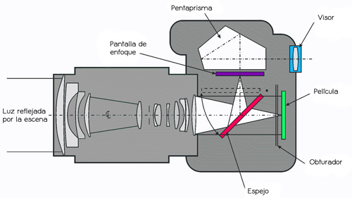
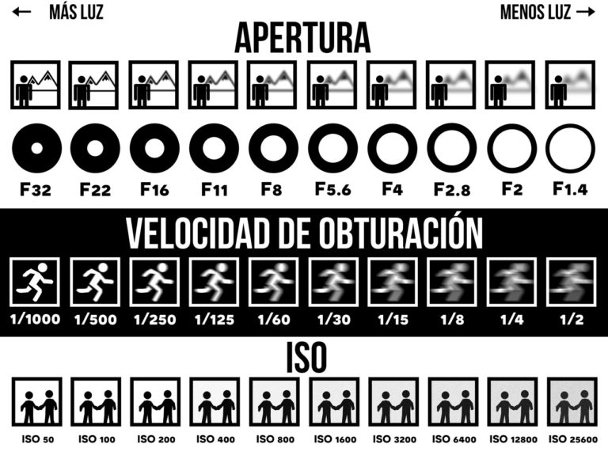
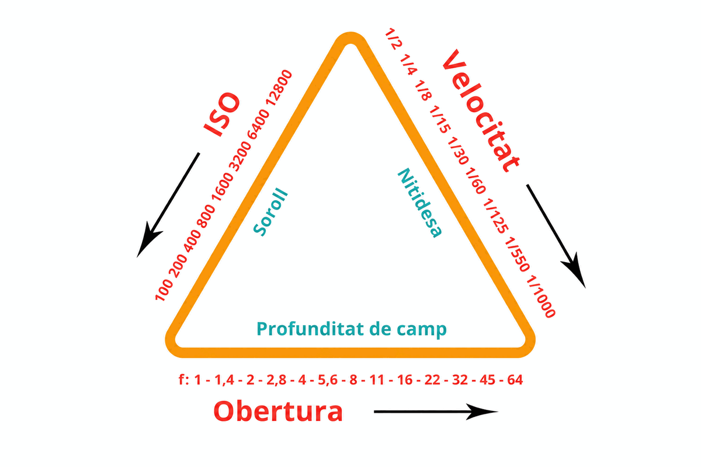
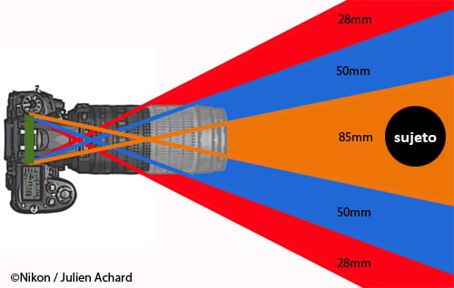
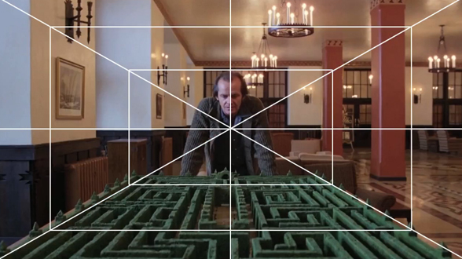

## Abans de començar

Aquest document arriba **després** del taller, no abans. Durant quatre hores hem obert la càmera, hem carregat un carret i hem fet fotos amb el triangle d'exposició a la mà. Aquí tens el resum del que vam fer, els números que no cal memoritzar, els exercicis per continuar sol i les referències per anar més enllà.

Com està organitzat:

- El cos del document segueix l'ordre del taller. Es pot llegir del dret.
- Les taules són de consulta: no cal saber-se les escales de diafragma de memòria, només saber-les llegir.
- Els apèndixs guarden la part més tècnica (el procés fotoquímic, els formats de carret) i els recursos: simuladors i bibliografia.

## Per què una càmera analògica

La fotografia de tota la vida. L'argèntica, la química, la que es va fer servir durant cent quaranta anys i que encara avui és la manera més honesta d'aprendre a exposar. No és millor que el digital: és diferent, i aquesta diferència ens interessa.

Una càmera analògica no menteix. No hi ha pantalla que et digui si la foto ha sortit bé, no hi ha histograma que et corregeixi la decisió, no hi ha segona oportunitat immediata. Has de pensar abans de disparar, i quan dispares has de confiar en el que has decidit. Això és el que fa que aprenguis de pressa: cada carret són 36 decisions (24 o 12, segons el rodet), no 36.000.

També hi ha el carret com a objecte. El poses a la càmera, l'avança, l'acabes, el reveles i n'obtens un negatiu. La foto existeix en algun lloc físic. Per a molta gent això és el motiu; per a tu potser és només el mitjà. Tant és: el que aprens aquí serveix igual amb una càmera digital.

**Si véns del digital.** Posa la càmera en mode manual, fixa l'ISO a 400, tria una distància focal i no la moguis. Fes comptes: tens 36 fotos, com un carret. El límit és el que ensenya.

## La càmera: una caixa de llum

Una càmera és una caixa que deixa entrar llum durant un temps determinat. Tot el que té a dins serveix per controlar quanta llum entra i durant quant temps.

- **L'objectiu** recull la llum i la fa convergir cap a la pel·lícula.
- El **diafragma** és el forat per on passa la llum. S'obre i es tanca en passos, i cada pas és el doble o la meitat de llum.
- L'**obturador** és la cortina que descobreix la pel·lícula durant un temps: un segon, un centèsim, un mil·lèsim.
- El **visor** et deixa veure què entrarà al marc (amb més o menys exactitud segons el tipus de càmera).
- El **fotòmetre** mesura la llum de l'escena i proposa una combinació. La majoria de càmeres dels anys setanta ençà en porten un; les mecàniques més antigues, no.
- L'**avançament** i el **rebobinat** mouen el carret foto a foto.

Per tipus, te'n trobaràs de compactes, de telemètre (rangefinder), reflex (SLR), de dos objectius (TLR) i de mig i gran format. Per començar no cal triar: qualsevol càmera que funcioni i que t'entenguis és bona. El que sí que has de saber fer és carregar-la.

### Carregar el carret

És l'error número u del principiant i no té res a veure amb l'exposició: el carret no ha enganxat i has tornat a casa amb la càmera buida.

1. Obre la tapa en penombra, mai al sol.
2. Col·loca el carret al costat que li toca i estira la llengüeta fins a la ranura del rodet receptor.
3. Enganxa-la bé, amb el forat del rodet o la ranura, i fes un parell de voltes amb la maneta perquè quedi ferm.
4. **Comprova l'encaix**: mira que els forats de la pel·lícula coincideixin amb els engranatges que la fan avançar. Si no hi encaixen, la pel·lícula no avançarà encara que la maneta giri.
5. Tanca la tapa.
6. **Comprova-ho amb la tapa tancada**: avança amb la palanca i mira la roda de rebobinat. Ha de girar. Si no es mou, el carret no ha enganxat.
7. Mira el comptador: ha d'anar pujant.

Si en algun moment notes que la palanca d'avançament va molt fluixa, atura't: és senyal que la pel·lícula s'ha soltat.

## Llum, temps i sensibilitat

Tota la fotografia es redueix a tres variables i una pregunta: quanta llum necessita la pel·lícula perquè la imatge hi quedi ben impresa?

- **Quanta llum entra**: el diafragma.
- **Durant quant temps entra**: la velocitat d'obturació.
- **Quanta llum necessita**: la sensibilitat ISO del carret.

Pensa en una aixeta. El diafragma és com d'oberta la clau; la velocitat, els segons que la deixes oberta; l'ISO, la mida del got que hi poses a sota. Si obres més la clau, has de tancar abans. Si el got és més petit, has d'omplir menys estona i eixa.

## El triangle d'exposició

Les tres variables es mouen juntes. Canviar-ne una obliga a moure'n una altra, i aquesta és tota la gràcia: cada combinació possible dona una foto diferent.

### Diafragma

El diafragma es mesura en números f. Com més gran és el número, més petit és el forat i menys llum entra. Cada pas d'aquesta escala és exactament el doble o la meitat de llum:

| f/1.4 | f/2 | f/2.8 | f/4 | f/5.6 | f/8 | f/11 | f/16 | f/22 |
|-------|-----|-------|-----|-------|-----|------|------|------|

De f/4 a f/5.6 hi ha un pas: la meitat de llum. De f/4 a f/8 hi ha dos passos: una quarta part.

### Velocitat d'obturació

El temps que l'obturador deixa entrar la llum. L'escala estàndard també va de doble en doble:

| 1 s | 1/2 | 1/4 | 1/8 | 1/15 | 1/30 | 1/60 | 1/125 | 1/250 | 1/500 | 1/1000 |
|-----|-----|-----|-----|------|------|------|-------|-------|-------|--------|

Per sota de la velocitat equivalent a la teva distància focal, el pols se't nota. Amb un 50 mm, dispara a 1/60 o més ràpid. Amb un 135 mm, a 1/250.

### ISO

La sensibilitat del carret. El trobaràs en ISO o ASA: 100, 200, 400, 800, 1600. Com més alt, menys llum necessites i més gra obtens. Per començar, **400** és el rodet més polivalent: serveix de dia i de nit, i el gra que dona és part de l'encant.

### Les tres escales es compensen

Aquestes quatre combinacions donen exactament la mateixa llum, però no la mateixa foto:

| Diafragma | Velocitat | Resultat |
|-----------|-----------|----------|
| f/4 | 1/500 | Fons desenfocat, acció congelada |
| f/5.6 | 1/250 | Equilibri, retrat a l'aire lliure |
| f/8 | 1/125 | Tot nítid, gent quieta |
| f/11 | 1/60 | Paisatge, primer pla i fons nítids |
| f/16 | 1/30 | Molta profunditat de camp, risc de trepidar |

Aquesta taula és el cor del taller. Quan dubtis, tria primer què vols que passi (fons desenfocat? acció congelada?) i ajusta la resta.

No hi ha una exposició perfecta. Hi ha la que vols. Una foto fosca pot ser un error o pot ser una decisió; el negatiu no distingeix entre les dues coses, i això et dona tota la llibertat.

## Dins el carret: per què no hi ha segona oportunitat

Quan dispares, la llum impressiona la pel·lícula i hi deixa una **imatge latent**: una diferència invisible de plata que només es farà visible al revelat. Des d'aquell moment la imatge ja està presa. No hi ha previsualització, no hi ha esborrar, no hi ha segona presa idèntica.

Cada carret permet un marge d'error. El negatiu en blanc i negre té **latitud**: pots equivocar-te un parell de passos i la còpia encara es pot salvar. La diapositiva no en té cap: mig pas i has perdut la foto. Aquesta és una bona raó per començar amb blanc i negre.

I el **gra**: com més alt és l'ISO, més grans són els cristalls de plata i més visible és la textura. El gra no és un defecte. Moltes fotografies que recordes tenen gra perquè la pel·lícula era de 400 i la llum era poca.

## Mesurar la llum

El fotòmetre no pensa: mesura. La seva feina és dir-te una combinació de diafragma i velocitat que deixi la imatge a un gris mitjà. Aquest gris és el 18% de la llum, i és l'error de fons de tot el sistema: **el fotòmetre vol que tot sigui gris mitjà**.

Hi ha dues maneres de mesurar:

- **Llum incident**: mesures la llum que cau sobre el motiu, amb un fotòmetre extern o posant la mà o una targeta davant l'objectiu. És el mètode més fiable, perquè mesura la llum real i no el que reflecteix cada cosa.
- **Llum reflectida**: mesures la llum que l'escena envia cap a la càmera. És el que fa el fotòmetre intern. És còmode, però s'equivoca sempre que l'escena no és grisa.

Quan el fotòmetre menteix, i et dirà la veritat:

| Escena | Què fa el fotòmetre | Què has de fer |
|--------|---------------------|----------------|
| Neu, platja, cel molt clar | La deixa grisa i fosca | Obre 1 o 2 passos |
| Objecte negre, escena fosca | La deixa grisa i clara | Tanca 1 pas |
| Contrallum, finestra darrere | Subexposa el motiu | Obre 1 pas i mig o mesura de prop |
| Concert, nit, llums puntuals | Sobreexposa | Tanca 1 o 2 passos i accepta el negre |

En negatiu, **exposa per les ombres**: les ombres tenen informació i les llums es poden cremar. En diapositiva, al revés: exposa per les llums.

## Profunditat de camp

La profunditat de camp és la distància per davant i per darrere del punt enfocat que surt nítida. Depèn de tres coses:

- **L'obertura**: com més obert (f/2.8), menys profunditat de camp.
- **La distància focal**: com més tele (135 mm), menys profunditat de camp.
- **La distància al motiu**: com més a prop estàs, menys profunditat de camp.

| Vols | Obertura | Exemple |
|------|----------|---------|
| Aïllar el motiu del fons | f/2 a f/4 | Retrat, detall, bodegó |
| Un grup de dues o tres persones | f/5.6 a f/8 | Retrat de grup |
| Tota l'escena nítida | f/11 a f/16 | Paisatge, arquitectura, carrer |

El **bokeh** és la manera com es desenfoca el que queda fora de focus, i depèn del nombre de fulles del diafragma i de la distància entre el motiu i el fons. No és el mateix que la profunditat de camp: és el caràcter del desenfocament.

## Distància focal i perspectiva

La distància focal és la distància entre el centre de l'objectiu i el pla on es forma la imatge, i es mesura en mil·límetres. En un 35 mm, **50 mm és l'objectiu normal**: dona aproximadament el camp de visió de l'ull humà.

| Focal | Angle | Per a què |
|-------|-------|-----------|
| 14–24 mm | Molt gran angular | Arquitectura, paisatge, interiors |
| 28–35 mm | Gran angular | Carrer, reportatge, paisatge |
| 50 mm | Normal | Ús general, retrat ambiental |
| 85–105 mm | Teleobjectiu curt | Retrat |
| 135–300 mm | Teleobjectiu | Esport, natura, reportatge |

La focal no només acosta o allunya: **canvia la perspectiva**. Amb un gran angular t'arribes a prop i el fons s'allunya; amb un tele, el fons s'hi arrapa i els plans es comprimeixen.

## Composició

L'exposició decideix si la foto es veu. La composició decideix si val la pena mirar-la. No hi ha regles, hi ha decisions que funcionen més sovint que altres.

### El marc és una decisió

Enquadrar és triar què queda fora. Abans de disparar, pregunta't què és el que t'interessa de veritat i treu del marc tot el que no hi té res a veure. La majoria de fotos fluixes ho són perquè hi ha massa coses.

### On poses la càmera

És el canvi més barat i el que menys es fa. Ajup-te, puja't a una cadira, acosta't mig metre. Un punt de vista a l'alçada dels ulls de tothom produeix una foto que tothom ha fet. Un punt de vista a l'alçada del motiu (un nen, un gos, una tassa) ja és una altra foto.

### El fons

El fons és la meitat de la fotografia i gairebé mai no es mira. Un motiu perfecte amb un fons d'arbres, fanals i papers a terra no funciona. Mou-te dos passos i mira què hi ha darrere: busca un fons net, un color pla o una textura que no competeixi.

### Línies i horitzó

Les línies guien la mirada. Una diagonal dona moviment; una horitzontal, calma; una vertical, ordre. L'horitzó no ha d'anar al mig per costum: posa'l a un terç, amunt o avall, segons què vulguis que domini, el cel o la terra.

### Aire, tensió i talls

Deixa aire cap on mira o camina el motiu; si el poses enganxat a la vora, la foto s'asfixia. No tallis per les articulacions (canells, genolls, turmells); talla per la meitat del braç o de la cuixa. I si has de retallar, retalla amb intenció, no perquè no hi cabia.

### Regla dels terços

Divideix el marc en tres franges horitzontals i tres de verticals. Els punts on es creuen són llocs on l'ull descansa. No és una llei i sovint funciona millor trencar-la, però mentre no tinguis criteri propi és una bona xarxa de seguretat.

### El moment

En fotografia de carrer i de gent, el moment és el contingut. Esperar mig segon més pot canviar la foto: una mirada, una mà, un gest. Amb una analògica no tens ràfega, i això et força a anticipar. Sovint això és un avantatge.

### L'ordre de les decisions

1. Què vull explicar amb aquesta foto?
2. On em poso?
3. Què entra al marc i què en queda fora?
4. Quina focal necessito?
5. Només al final: quina exposició.

Fer-ho en aquest ordre és el que separa una foto pensada d'una foto feta.

## Practicar: sis exercicis amb un carret

Un carret són 36 fotos (24 o 12, segons el rodet). Amb aquests sis exercicis en tens per a dos o tres carrets, i cada un t'ensenya una cosa que no s'aprèn llegint.

1. **Una focal, tot el carret.** Tria un 50 mm (o no moguis el zoom) i fes les 36 fotos amb ell. Mou-te tu per enquadrar, no l'objectiu.
2. **Els tres graons.** Un mateix motiu, quiet, a f/2.8, f/8 i f/16, ajustant la velocitat cada cop. Compara les tres còpies quan les tinguis.
3. **Congelar i estovar.** El mateix moviment (una persona caminant, aigua, un gronxador) a 1/500, 1/60 i 1/15. Les dues últimes amb trípode o amb el cos ben recolzat.
4. **El fotòmetre contra el món.** Una escena amb neu, un objecte negre i un contrallum, amb la mesura que et proposa la càmera i amb la teva correcció. Apunta què has fet.
5. **Tres punts de vista.** Tria un sol motiu i fotografia'l des de tres alçades diferents. Després tria'n una.
6. **Bracketing manual.** El mateix motiu amb l'exposició "correcta", un pas per sobre i un pas per sota. Serveix per aprendre quant és un pas.

**Consell de taller:** apunta cada foto en una llibreta (número, lloc, obertura, velocitat). Sense això, quan arribi el negatiu no sabràs per què una foto ha sortit com ha sortit, i l'aprenentatge es perd.

## Errors freqüents

| Símptoma | Causa | Solució |
|----------|-------|---------|
| Totes les fotos mogudes | Velocitat massa baixa per la focal | 1/60 o més, o trípode; bufa l'aire abans de disparar |
| El negatiu surt clar, rentat | Subexposició, sovint per fons molt clar | Obre 1 o 2 passos; mesura de prop |
| El negatiu surt molt fosc | Sobreexposició, escena fosca | Tanca 1 pas; recorda que el negatiu té latitud |
| Només hi ha 8 o 12 fotos | El carret no va enganxar | Torna a carregar i comprova la tensió del rebobinat |
| Banda fosca o ratlles | Pel·lícula mal col·locada o obturador irregular | Revisa la càrrega; si és la càmera, pregunta'ns |
| El carret està velat | Es va obrir la càmera amb llum o es va treure el carret sense rebobinar | Rebobina sempre abans d'obrir |
| Gents tallades o deformades | Massa a prop amb un gran angular | Allunya't o canvia de focal |
| Fotos avorrides | No hi ha cap decisió de punt de vista | Torna a la composició: on et poses i què deixes fora |

## Què fer amb el carret

- **No l'obris.** Ni per curiositat: la llum el velaria en segons.
- Guarda'l en un lloc sec i fresc, lluny de la calor del cotxe o del sol directe.
- Revela'l aviat. La imatge latent es degrada amb el temps, sobretot amb calor.
- **Guarda el negatiu.** És l'original. Les còpies es poden tornar a fer; el negatiu no es pot recuperar.
- Demana sempre **revelat i full de contactes**. El full de contactes és el teu mapa: hi veuràs les 36 fotos juntes i entendràs d'un cop d'ull què vas fer bé.

El revelat no està inclòs al taller. Es fa al [Taller de Revelat B/N](/tallers/revelat-bn/) o a qualsevol laboratori de confiança.

## Per continuar

Amb el carret revelat i la llibreta a la mà ja tens el que necessites. Si vols seguir:

- **Revelar tu mateix**: [Taller de revelat B/N](/tallers/revelat-bn/) i [Iniciació al revelat](/tallers/iniciacio-revelat/).
- **Sortir a fotografiar**: [Fotografia de carrer](/tallers/fotografia-de-carrer/).
- **Construir una càmera senzilla**: [Fotografia estenopeica](/tallers/fotografia-estenopeica/).
- **Retrat amb la llum que hi ha**: [Retrat analògic](/tallers/retrat-analogic/).
- **Per entendre el perquè de dir-nos químics**: [Fotografia analògica o química?](/blog/fotografia-analogica-o-quimica/).

I una recomanació de pràctica: un carret al mes, un tema, una focal. Al cap d'un any tindràs dotze temes i un criteri propi, que és molt més del que dona qualsevol curs.

## Xinxeta

**Les tres escales** (cada pas, meitat o doble de llum)

| | | | | | | |
|---|---|---|---|---|---|---|
| Diafragma | 2 | 2.8 | 4 | 5.6 | 8 | 11 |
| Velocitat | 1/500 | 1/250 | 1/125 | 1/60 | 1/30 | 1/15 |
| ISO | 100 | 200 | 400 | 800 | 1600 | 3200 |

**Cinc configuracions per començar**

| Situació | Obertura | Velocitat | ISO |
|----------|----------|-----------|-----|
| Retrat a l'aire lliure | f/2.8 | 1/250 | 400 |
| Paisatge amb llum | f/11 | 1/125 | 100 |
| Carrer, gent en moviment | f/8 | 1/250 | 400 |
| Moviment intencionat | f/11 | 1/15 | 100 |
| Interior amb poca llum | f/2 | 1/30 | 800 |

**Abans de disparar, quatre preguntes:** què vull explicar, on em poso, què entra al marc, quina exposició.

**Abans de marxar de casa:** carret carregat i comprovat, comptador a zero, bateria o pila, tapa de l'objectiu, llibreta.

## Apèndix A · El procés fotoquímic

La fotografia argèntica es basa en un material sensible a la llum: una emulsió de gelatina amb **halurs de plata** (bromur, clorur, iodur) estesa sobre un suport flexible, normalment acetat de cel·lulosa o polièster.

Quan la llum hi incideix, els halurs de plata reaccionen i formen una **imatge latent**: una distribució de plata metàl·lica invisible a l'ull. Com més grans són els cristalls d'halur de plata, més sensible és l'emulsió i més gra dona; aquesta és la diferència entre un ISO 100 i un ISO 1600.

Al **revelat**, el revelador redueix els halurs exposats a plata metàl·lica negra i fa visible la imatge. El **fixador** atura el procés i elimina els halurs que no s'han exposat, perquè la imatge no continuï revelant-se amb la llum. El resultat és el **negatiu**: els valors de llum estan invertits.

Per obtenir una imatge positiva es torna a fer passar llum a través del negatiu cap a un paper sensible (**positivat**, per ampliació o per contacte). Amb pel·lícula de diapositiva, en canvi, el revelat dona directament un positiu.

## Apèndix B · Formats i tipus de carret

| Format | Mida | On el trobes |
|--------|------|--------------|
| 135 (35 mm) | 24 × 36 mm | La majoria de càmeres reflex i compactes |
| 120 (mig format) | 6 × 4,5 / 6 × 6 / 6 × 7 cm | Reflex de mig format, TLR, telemètriques |
| Instantània | Polaroid, Fuji Instax | Càmeres instantànies |
| Gran format | 4 × 5", 5 × 7", 8 × 10" | Càmeres tècniques de banc |

| Tipus | Què dona | Per a què |
|-------|----------|-----------|
| Negatiu B/N | Imatge en grisos, gran marge d'error | Aprendre, carrer, retrat |
| Negatiu color | Colors complementaris al negatiu | Ús general en color |
| Diapositiva | Positiu directe, sense latitud | Projections, revistes, color exacte |
| Infraroig B/N | Tons irreals, efecte halo | Experimentació |
| Lith o de línia | Contrast extrem, blanc i negre pur | Grafisme, còpia d'art |

## Apèndix C · Simuladors i recursos

- **CameraSim** · [camerasim.com](https://www.camerasim.com/). El simulador clàssic: una escena amb moviment i profunditat on canvies diafragma, velocitat i ISO i veus en directe com canvia el desenfocament, el moviment i el gra. Té dues versions, *Original CameraSim* i *Exposure Contraption*, aquesta segona com un bodegó mecànic on muntes l'exposició peça a peça.
- **Photoskop** · [photoskop.com](https://photoskop.com/). Lliçons interactives amb escenes d'estudi: exposició, moviment i objectius, movent controls en lloc de llegir teoria.
- **Tria un tema i un carret al mes**: no és una app, és un mètode. Un tema, una focal, 36 fotos.

## Apèndix D · Bibliografia

**Tècnica i exposició**

- Ansel Adams, *The Camera* (1980), *The Negative* (1981) i *The Print* (1983). Little, Brown.
- Henry Horenstein, *Black and White Photography: A Basic Manual*. Little, Brown.
- Michael Langford, *Basic Photography*. Focal Press.
- Bryan Peterson, *Understanding Exposure*. Amphoto Books.
- Bruce Barnbaum, *The Art of Photography*. Rocky Nook.

**Laboratori**

- Steve Anchell i Bill Troop, *The Film Developing Cookbook*. Focal Press.
- Steve Anchell, *The Darkroom Cookbook*. Focal Press.

**Composició i mirada**

- Michael Freeman, *The Photographer's Eye*. Ilex Press, 2007.
- Henri Cartier-Bresson, *The Decisive Moment*. 1952.
- Stephen Shore, *The Nature of Photographs*. Phaidon, 2007.
- David Hurn i Bill Jay, *On Being a Photographer*. LensWork, 1997.

**Pensar la fotografia**

- Susan Sontag, *On Photography*. 1977.
- Roland Barthes, *La càmera lúcida*. 1980.
- Joan Fontcuberta, *La cámara de Pandora*. Gustavo Gili, 2010.

**De casa**

- Llumàtics, [Fotografia analògica o química?](/blog/fotografia-analogica-o-quimica/). Per què diem química quan tothom diu analògica.

## Apèndix E · Glossari

- **Diafragma**: forat de l'objectiu que regula la quantitat de llum. Es mesura en números f.
- **Obturador**: dispositiu que descobreix la pel·lícula durant un temps determinat.
- **ISO / ASA**: sensibilitat de la pel·lícula a la llum. Més ISO, menys llum necessària i més gra.
- **Pas (stop)**: unitat de canvi d'exposició. Un pas és el doble o la meitat de llum.
- **EV**: valor d'exposició. Resumeix una combinació de diafragma i velocitat en un sol número.
- **Profunditat de camp**: distància per davant i per darrere del punt enfocat que surt nítida.
- **Bokeh**: caràcter del desenfocament fora de focus.
- **Distància focal**: distància entre el centre òptic de l'objectiu i el pla de la imatge, en mm.
- **Hiperfocal**: distància d'enfocament a partir de la qual tot surt nítid fins a l'infinit.
- **Latitud d'exposició**: marge d'error que suporta una pel·lícula sense perdre la imatge.
- **Gra**: textura visible que produeixen els cristalls d'halur de plata.
- **Imatge latent**: imatge invisible que queda a la pel·lícula en disparar.
- **Negatiu**: imatge amb els valors de llum invertits, tal com surt del revelat.
- **Positiu**: imatge amb els valors correctes, obtinguda per positivat o amb diapositiva.
- **Revelador**: solució que converteix la imatge latent en plata metàl·lica visible.
- **Fixador**: solució que atura el revelat i fa estable la imatge.
- **Fotòmetre**: aparell que mesura la llum i proposa una exposició.
- **Gris 18%**: gris mitjà que el fotòmetre pren com a referència i que vol imposar a tota l'escena.
- **Full de contactes**: còpia de tot el negatiu en positiu, en un sol full, per triar fotos.
- **Velar**: exposar accidentalment la pel·lícula a la llum.

